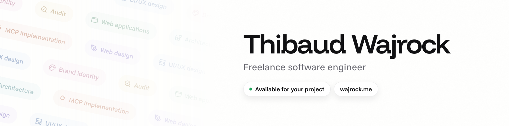

<a href="https://wajrock.me">
  <picture>
    <source media="(prefers-color-scheme: dark)" srcset="./assets/banner-dark.png">
    
  </picture>
</a>

I design and build web products made for their users, from design to code: UI/UX design, audits, web applications, architecture and MCP integration.

  
  
  
  

## Currently working on

| Project | What I do |
| --- | --- |
| **[eDisplay](https://edisplay.it)** | Freelance mission on [turboSMTP](https://serversmtp.com) and [Emailchef](https://emailchef.com): evolving the products and their user experience |
| **[Tabularis](https://github.com/TabularisDB/tabularis)** | Open source SQL client: I [rebuilt the website](https://github.com/TabularisDB/website) (UX/UI and front-end) and bring its visual identity to the app |
| **[wajrock.me](https://wajrock.me)** | My portfolio, built with Astro |

## Open source

- **[Tabularis](https://github.com/TabularisDB)**: rebuilt the [website](https://github.com/TabularisDB/website) (landing page, wiki, light theme, download page), designed the [new logo and icons](https://github.com/TabularisDB/tabularis/pull/935) of the app, and rebranded [explain-plan](https://github.com/TabularisDB/explain-plan/pull/9)
- **[ng-primitives](https://github.com/ng-primitives/ng-primitives)**: fixes for [dialogs](https://github.com/ng-primitives/ng-primitives/pull/924) and [switch keyboard activation](https://github.com/ng-primitives/ng-primitives/pull/927)
- **[zard/ui](https://github.com/zard-ui/zardui)**: the [aspect-ratio component](https://github.com/zard-ui/zardui/pull/748)
- **[spartan](https://github.com/spartan-ng/spartan)**: `ngSrc` support on the avatar, [kept in the reworked component](https://github.com/spartan-ng/spartan/pull/1821)

---

Got a project? <a href="https://wajrock.me">Book a free call on wajrock.me</a>.
